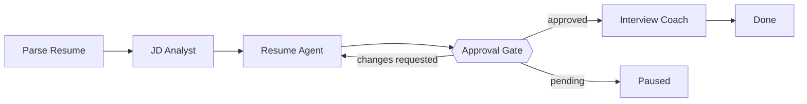

# NextRole

**AI-powered resume tailoring and interview-prep tool**, built on a multi-agent pipeline orchestrated with [LangGraph](https://github.com/langchain-ai/langgraph) and powered by open-source LLMs via [Ollama](https://ollama.com) — no cloud LLM API and no recurring usage cost.

Give it your resume and a job description; it parses your resume, analyzes the job description, tailors your resume to it (without fabricating experience), and generates interview preparation material (self-introduction, technical/HR/project questions with STAR-format answers) — all reviewable and approvable before export.

> This repository implements Phases 1–3 of the project (the MVP): resume parsing, JD analysis, resume tailoring, interview prep, LangGraph orchestration, a FastAPI backend, a React frontend, SQLite persistence, and PDF export. Company research, chat-based document editing, and URL-based job description ingestion are documented as future phases in [`docs/scope.md`](docs/scope.md) and are **not** implemented here.

## Table of Contents

- [Demo](#demo)
- [Overview](#overview)
- [Key Features](#key-features)
- [Tech Stack](#tech-stack)
- [Architecture](#architecture)
- [Project Structure](#project-structure)
- [Prerequisites](#prerequisites)
- [Installation](#installation)
- [Configuration](#configuration)
- [Usage](#usage)
- [API Reference](#api-reference)
- [Testing](#testing)
- [Evaluation Dataset](#evaluation-dataset)
- [Known Limitations](#known-limitations)
- [License](#license)
- [Further Reading](#further-reading)

## Demo

<!-- TODO: replace with your hosted demo recording. A local walkthrough
     (`nextrole demo.mp4`) is not included in this repository because of its
     size — upload it to YouTube, Loom, or a similar host and link it here,
     e.g.: -->
> 🎥 [Watch the demo](#) — resume upload, JD analysis, tailoring, approval, interview prep, and PDF export end to end.

## Overview

Job seekers routinely spend hours re-tailoring a resume for each job posting and preparing answers for interviews, work that is fragmented across editors, search engines, and note apps. NextRole automates that preparation loop end to end: upload a resume, paste a job description, and a small set of specialized agents — coordinated through a LangGraph state machine — produce a tailored resume and interview prep material, with a human approval step before anything is exported.

The system is designed for single-user use: the LLM runs through Ollama, documents persist in SQLite, and the stack consists of your own browser, FastAPI server, and Ollama instance — no resume data is sent to a third party.

## Key Features

- **Resume parsing** — Extracts structured text/sections from uploaded PDF or DOCX resumes.
- **Job description analysis** — Extracts required skills, responsibilities, experience requirements, keywords, and preferred qualifications from pasted JD text.
- **Guardrailed resume tailoring** — Rewrites resume content to align with the job description's language and priorities while enforcing that nothing is tailored beyond what's supported by the original resume; fabrication and unsupported-metric checks flag suspect content instead of silently "fixing" it.
- **Interview preparation** — Generates a self-introduction plus technical, HR/behavioral, and project-based questions, each with a resume-grounded STAR-format answer.
- **Human-in-the-loop approval** — The tailored resume pauses at an approval gate; the pipeline only proceeds to interview-prep generation after the resume is approved, and can loop back for another tailoring pass if changes are requested.
- **PDF export** — Renders the approved tailored resume to PDF via RenderCV, blocked until approval (and until any guardrail flags are resolved).
- **Persistence** — Sessions, parsed resumes, generated documents, and approval history are stored in a SQLite database.
- **Bounded retries & graceful failure** — Each pipeline node retries a configurable number of times on transient/malformed LLM output before halting that branch, preserving whatever output earlier nodes already produced.

## Tech Stack

| Layer | Technology |
|---|---|
| Agent orchestration | [LangGraph](https://github.com/langchain-ai/langgraph) (`StateGraph`, `InMemorySaver` checkpointer, interrupt-based approval gate) |
| LLM runtime | [Ollama](https://ollama.com), accessed via the `ollama` Python client |
| Backend framework | [FastAPI](https://fastapi.tiangolo.com/) + [Pydantic](https://docs.pydantic.dev/) v2 (request/response and schema validation) |
| ASGI server | [Uvicorn](https://www.uvicorn.org/) |
| Resume parsing | [PyMuPDF](https://pymupdf.readthedocs.io/) (PDF) and [python-docx](https://python-docx.readthedocs.io/) (DOCX) |
| PDF rendering | [RenderCV](https://github.com/rendercv/rendercv) |
| Persistence | SQLite (via the standard library `sqlite3` module) |
| Configuration | [python-dotenv](https://github.com/theskumar/python-dotenv) (`.env` file support) |
| Frontend | [React 19](https://react.dev/) + [Vite 8](https://vite.dev/) (no router or global state library; hand-rolled API client and polling) |
| Testing | [pytest](https://docs.pytest.org/) |

## Architecture

**Backend** (`backend/`) follows a layered, service-oriented structure:

- `api/` — thin FastAPI route handlers that delegate to services and translate domain errors into HTTP responses.
- `services/` — upload/parsing, pipeline-run orchestration, document retrieval, and approval business logic.
- `pipeline/` — the LangGraph graph definition and shared pipeline state.
- `agents/` — one module per agent (`jd_analyst.py`, `resume_agent.py`, `interview_coach.py`).
- `llm/` — a single integration point wrapping the Ollama client, with structured-output validation and retries.
- `models/` — Pydantic schemas for both API payloads and pipeline state.
- `db/` — SQLite schema and data-access functions.
- `rendering/` — the RenderCV adapter that turns a tailored resume into a PDF.

**Frontend** (`frontend/`) is a small React SPA with no router (a single `sessionId` piece of state decides whether the Upload page or the Review page is shown):

- `src/pages/` — `UploadPage` (resume + JD submission) and `ReviewPage` (pipeline status, generated documents, approval controls).
- `src/components/` — `AppHeader`, `ProgressIndicator`, `DocumentViewer`, `ApprovalControls`, `ErrorBanner`.
- `src/api/client.js` — a single module centralizing every call to the FastAPI backend.

**Pipeline flow** — the LangGraph state machine implemented in `backend/pipeline/graph.py`:



Each node reads and writes a shared `PipelineState` object. The `approval_gate` node is a real LangGraph interrupt point (`interrupt_before`): the run pauses there until the `/resume/approve` or `/resume/reject` endpoint resumes it with the user's decision. On an unrecoverable node failure, only that branch halts — documents already produced by earlier nodes are preserved and returned alongside a halt reason.

## Project Structure

```
NextRole/
├── backend/
│   ├── agents/          # jd_analyst.py, resume_agent.py, interview_coach.py
│   ├── api/             # FastAPI routers
│   ├── services/        # upload, pipeline-run, document, approval services
│   ├── pipeline/        # LangGraph graph + shared state
│   ├── llm/             # Ollama client wrapper
│   ├── rendering/       # RenderCV adapter
│   ├── models/          # Pydantic schemas
│   ├── db/              # SQLite schema + data access
│   ├── config.py        # environment-driven settings
│   └── main.py          # FastAPI app entry point
├── frontend/
│   ├── src/pages/       # UploadPage, ReviewPage
│   ├── src/components/  # AppHeader, ProgressIndicator, DocumentViewer, ...
│   └── src/api/         # client.js (API client)
├── tests/               # pytest suite: agents, pipeline, guardrails, services, e2e
├── dataset/             # offline dataset-curation pipeline for the agent-quality golden eval set
├── docs/                # scope.md, requirements.md, spec.md
├── LICENSE
└── pytest.ini
```

## Prerequisites

- Python 3.12+
- Node.js 18+
- [Ollama](https://ollama.com) installed and running, with a model pulled, e.g.:
  ```powershell
  ollama pull llama3.1:8b
  ```

## Installation

**Backend**

```powershell
pip install -r backend/requirements.txt
python -m uvicorn backend.main:app --reload
```

The API runs at `http://localhost:8000`.

**Frontend**

```powershell
cd frontend
npm install
npm run dev
```

The app runs at `http://localhost:5173` and talks to the backend over HTTP.

## Configuration

Configuration is environment-variable driven (`backend/config.py`). Copy `.env.example` to `.env` in the project root and edit it — `backend/config.py` loads `.env` automatically via `python-dotenv` on startup. `.env` is gitignored, so real environment variables always take precedence if both are set.

| Variable | Default | Purpose |
|---|---|---|
| `NEXTROLE_OLLAMA_HOST` | `http://localhost:11434` | Ollama server URL |
| `NEXTROLE_OLLAMA_MODEL` | `llama3.1:8b` | Model used by every agent |
| `NEXTROLE_LLM_TEMPERATURE` | `0.2` | Sampling temperature for all LLM calls |
| `NEXTROLE_MAX_RETRIES` | `2` | Retries per pipeline node on transient/malformed LLM output |
| `NEXTROLE_RETRY_DELAY_SECONDS` | `1.5` | Fixed delay between retries |
| `NEXTROLE_MAX_RESUME_SIZE_MB` | `10` | Max accepted resume upload size |
| `NEXTROLE_JD_MIN_CHARS` | `50` | Minimum job description length |
| `NEXTROLE_JD_MAX_CHARS` | `20000` | Maximum job description length |
| `NEXTROLE_DB_PATH` | `nextrole.db` | SQLite database file path |
| `NEXTROLE_RENDERCV_OUTPUT_DIR` | `rendercv_output` | Directory for rendered PDF output |
| `NEXTROLE_RENDERCV_THEME` | `classic` | RenderCV theme used for the exported resume |

If your GPU has limited VRAM, a smaller model such as `llama3.2:3b` (~2GB) runs far more smoothly than the `llama3.1:8b` default on a 4GB card; pull it with `ollama pull llama3.2:3b` and set `NEXTROLE_OLLAMA_MODEL=llama3.2:3b`.

The frontend reads one optional build-time variable, `VITE_API_BASE_URL` (default `http://localhost:8000`), if the backend isn't running on its default host/port.

## Usage

1. Open `http://localhost:5173`.
2. On the **Upload** screen, choose a resume file (PDF or DOCX) and paste a job description (50–20,000 characters), then submit to start a session.
3. The **Review** screen polls pipeline status and shows a stepper for each stage: parse resume → analyze JD → tailor resume → await approval → generate interview prep.
4. Once the tailored resume is ready, review it (and the JD analysis) in the document tabs.
5. **Approve** the resume to let the pipeline continue to interview-prep generation, or **Request changes** to send it back through the Resume Agent for another pass.
6. Any fabrication or unsupported-metric flags on the resume are shown inline and must be resolved before export is enabled.
7. Once approved (and unflagged), **Export PDF** downloads the tailored resume.

## API Reference

All endpoints are served by the FastAPI backend at `http://localhost:8000` (see `backend/api/routes.py`):

| Method | Path | Purpose |
|---|---|---|
| `POST` | `/resumes` | Upload and parse a resume file |
| `POST` | `/sessions/{session_id}/jd` | Submit job description text for a session |
| `POST` | `/sessions/{session_id}/run` | Trigger the pipeline run (background task) |
| `GET` | `/sessions/{session_id}/status` | Poll overall and per-node run status |
| `GET` | `/sessions/{session_id}/documents` | Fetch generated documents (JD analysis, tailored resume, interview prep) |
| `POST` | `/sessions/{session_id}/resume/approve` | Approve the tailored resume |
| `POST` | `/sessions/{session_id}/resume/reject` | Request changes on the tailored resume |
| `GET` | `/sessions/{session_id}/resume/export` | Download the approved resume as a PDF |
| `GET` | `/health` | Health check |

## Testing

```powershell
python -m pytest
```

This runs the full suite under `tests/` (agents, guardrails, pipeline orchestration, services, and an end-to-end MVP workflow) against a fake Ollama client, so it doesn't require a live Ollama server. One additional LLM-as-a-Judge test is skipped by default; opt in with:

```powershell
$env:NEXTROLE_RUN_LLM_TESTS = "1"
python -m pytest -m llm
```

## Evaluation Dataset

`dataset/` holds an offline, standalone pipeline (separate from the running app) used to curate a small golden evaluation set for judging agent output quality. Numbered scripts under `dataset/scripts/` (`01_audit.py` → `08_finalize_llm_golden.py`) audit, clean, annotate, and validate resume/job-description pairs, with findings written to `dataset/reports/`.

The raw input (`train.csv`, a public resume/job-description matching dataset) and the large intermediate CSVs it produces are not committed to this repository (see `.gitignore`) — only the small final deliverables and reports are. To reproduce the pipeline, place your own `train.csv` (columns: `resume_text`, `job_description_text`, `label`) at the project root and run the scripts in order from the project root, e.g.:

```powershell
python dataset/scripts/01_audit.py
```

Its own test suite runs separately from the main suite:

```powershell
python -m pytest dataset/scripts/tests
```

## Known Limitations

- The LangGraph approval-gate pause uses an in-process `InMemorySaver` checkpointer, appropriate for a single-user, single-process deployment; an in-flight pending-approval run does not survive a backend process restart. Already-generated documents remain in SQLite regardless.
- The fabrication and fake-metric guardrails are best-effort heuristics (word-overlap traceability, numeric-claim checks, and JD-keyword-injection checks), not a guarantee of zero false negatives/positives.
- There is no endpoint to acknowledge flagged content; a tailored resume with unresolved guardrail flags stays export-blocked even after approval.

## License

Released under the [MIT License](LICENSE).

## Further Reading

Detailed scope, requirements, and technical design live in [`docs/scope.md`](docs/scope.md), [`docs/requirements.md`](docs/requirements.md), and [`docs/spec.md`](docs/spec.md).
