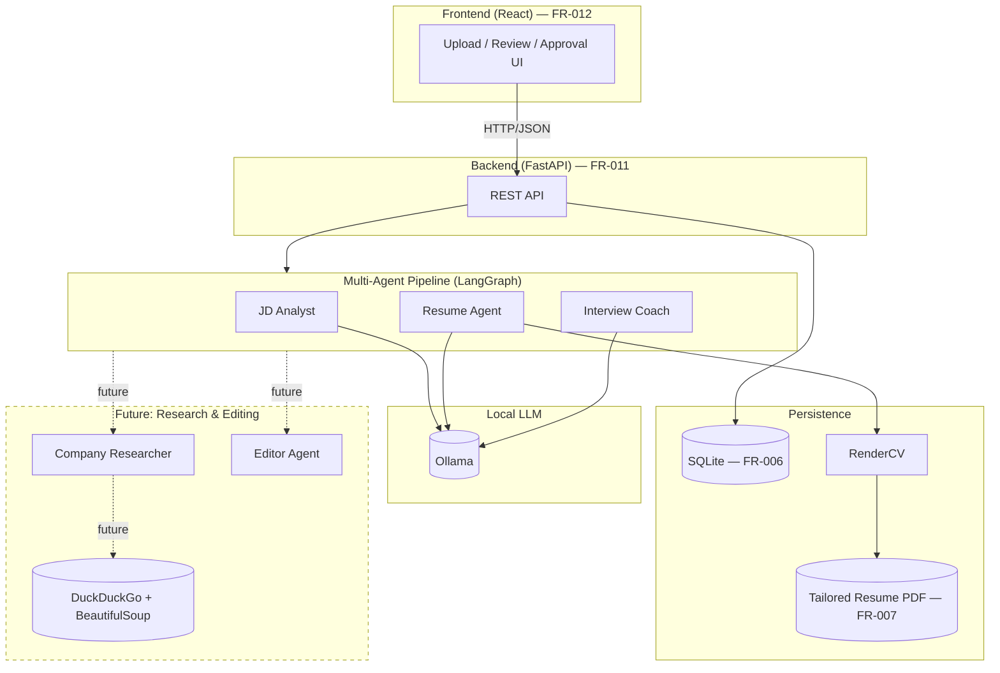
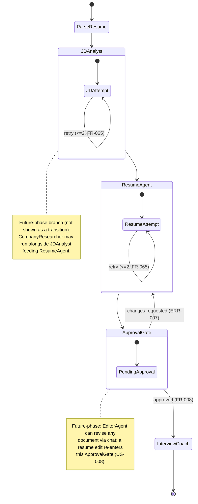

# NextRole — Technical Specification

> Derived from `docs/scope.md` (scope) and `docs/requirements.md` (PRD). This document specifies *how* the system is built; it does not redefine scope or requirements. Requirement IDs (FR/NFR/SEC/ERR/US) are referenced, not restated. Items not already settled by the source documents are marked **(Assumption)**.

## Table of Contents
1. [Architecture & Technology Stack](#1-architecture--technology-stack)
2. [Backend & Frontend Architecture](#2-backend--frontend-architecture)
3. [Multi-Agent Architecture (LangGraph)](#3-multi-agent-architecture-langgraph)
4. [Agent Responsibilities](#4-agent-responsibilities)
5. [Shared State & Pydantic Schemas](#5-shared-state--pydantic-schemas)
6. [Database Design](#6-database-design)
7. [FastAPI Endpoints](#7-fastapi-endpoints)
8. [Ollama / LLM Integration](#8-ollama--llm-integration)
9. [Resume Parsing & PDF Generation](#9-resume-parsing--pdf-generation)
10. [Guardrails, Validation & Security](#10-guardrails-validation--security)
11. [Error Handling & Retries](#11-error-handling--retries)
12. [Testing & Evaluation Strategy](#12-testing--evaluation-strategy)
13. [Project Folder Structure](#13-project-folder-structure)
14. [Implementation Phases & Dependencies](#14-implementation-phases--dependencies)

---

## 1. Architecture & Technology Stack

| Layer | Technology | Notes |
|---|---|---|
| Orchestration | LangGraph | Shared-state agent graph (NFR-006) |
| LLM runtime | Ollama (local) | No paid API as core dependency (NFR-004) |
| Backend | FastAPI + Pydantic | REST API, request/response validation (FR-011, FR-061) |
| Frontend | React | Upload/review/approval UI (FR-012) |
| Resume parsing | PyMuPDF (PDF), python-docx (DOCX) | FR-001/002 |
| PDF rendering | RenderCV | FR-007, FR-044 |
| Persistence | SQLite | FR-006 |
| Web research *(future)* | DuckDuckGo search + BeautifulSoup | FR-019/020 |
| Vector search *(future, optional)* | ChromaDB | Only if keyword extraction proves insufficient |
| Testing | Pytest | NFR-007 |



Runs single-machine, local-only (NFR-002/003), consistent with scope.md §6/§13.

---

## 2. Backend & Frontend Architecture

**FastAPI backend** (service-layer pattern):
- `api/` — route handlers, thin, delegate to services.
- `services/` — upload/parse service, pipeline-run service, document service, approval service.
- `pipeline/` — LangGraph graph definition + node wrappers.
- `agents/` — one module per agent.
- `models/` — Pydantic schemas (request/response + shared state).
- `db/` — SQLAlchemy models or raw SQLite access + migrations **(Assumption: SQLAlchemy Core or plain `sqlite3`, decided at implementation time)**.
- Long-running pipeline runs are executed as FastAPI `BackgroundTasks` (or a simple in-process queue), with the frontend polling run status (FR-062, FR-058).

**React frontend** (high-level, no UI library mandated):
- `pages/` — Upload, Review/Approval, (future) Chat.
- `components/` — per-document viewer, progress indicator, approve/request-changes controls (FR-050/052/053).
- State handling: local component state + a lightweight data-fetching layer (e.g., polling hook) for run status; no heavy global state library required at MVP scope **(Assumption)**.
- API client module centralizes calls to the FastAPI endpoints (Section 7).

---

## 3. Multi-Agent Architecture (LangGraph)

Single shared-state graph (FR-063) coordinates agent nodes with conditional routing (FR-064) and bounded retries (FR-065, up to 2 retries per requirements.md).



- Each node reads/writes a shared `PipelineState` object (Section 5).
- Conditional edges inspect per-node success/failure flags in state (FR-064).
- On exhausted retries, the branch halts; previously completed outputs are preserved and returned with a failure reason (FR-066, ERR-004/005).
- Approval gate (FR-008) is a graph node that pauses the run until the user approves or requests changes via the API, not an automatic transition.
- Editor Agent and Company Researcher nodes are present in the graph as future-phase branches; MVP graph executes only ParseResume → JDAnalyst → ResumeAgent → ApprovalGate → InterviewCoach.

---

## 4. Agent Responsibilities

| Agent | Phase | Responsibilities | Requirements |
|---|---|---|---|
| **JD Analyst** | MVP | Extract skills, responsibilities, experience requirements, keywords, preferred qualifications; output Pydantic-validated schema | FR-013–018 |
| **Resume Agent** | MVP | Tailor wording/emphasis to JD; no fabrication; add keywords only where backed by resume; output stays unapproved until user acts | FR-024–027 |
| **Interview Coach** | MVP | Generate self-intro, technical/HR/project questions, STAR answers grounded in resume | FR-029–033 |
| **Company Researcher** | Future | Web search, page extraction, product/business-model/culture/news summary, graceful degradation on failure | FR-019–023 |
| **Editor Agent** | Future | Interpret chat edit requests, resolve target document, maintain multi-turn context, support all 4 document types | FR-035–038 |

Each agent is an independently testable module (NFR-006), invoked as a LangGraph node that reads its required inputs from shared state and writes its output back into state.

---

## 5. Shared State & Pydantic Schemas

Core pipeline state (sketch; fields are illustrative, not exhaustive):

```pascal
STRUCTURE PipelineState
  session_id: UUID
  resume_raw_text: String
  resume_data: ResumeData
  jd_text: String
  jd_extraction: JDExtraction
  tailored_resume: TailoredResume
  interview_prep: InterviewPrep
  company_research: CompanyResearch OPTIONAL   // future
  node_status: Map<String, NodeStatus>          // per-node success/failure + retry count
  approval_status: ApprovalStatus
END STRUCTURE
```

Key schemas (illustrative shapes, kept short):

```pascal
STRUCTURE JDExtraction            // FR-013-018
  required_skills: List<String>
  responsibilities: List<String>
  experience_requirements: List<String>
  keywords: List<String>
  preferred_qualifications: List<String>
END STRUCTURE

STRUCTURE ResumeData              // FR-002
  sections: Map<String, List<String>>   // e.g., "experience" -> bullet list
  raw_text: String
END STRUCTURE

STRUCTURE TailoredResume          // FR-024-027
  sections: Map<String, List<String>>
  traceability_map: Map<String, String>   // tailored bullet -> source bullet, for SEC-002/003
  flagged_items: List<String>             // fabrication/metric guardrail hits
  approval_status: Enum(PENDING, APPROVED, CHANGES_REQUESTED)
END STRUCTURE

STRUCTURE InterviewPrep           // FR-029-033
  self_introduction: String
  technical_questions: List<QA>
  hr_questions: List<QA>
  project_questions: List<QA>

STRUCTURE QA
  question: String
  star_answer: String
END STRUCTURE
```

All agent outputs are validated against their Pydantic schema before being written to state (FR-018, FR-061); schema failures follow ERR-005.

---

## 6. Database Design

SQLite, single-user (NFR-008). High-level tables **(Assumption: exact columns/types finalized at implementation time)**:

| Table | Purpose | Key columns (illustrative) |
|---|---|---|
| `sessions` | One row per application/session (FR-006) | `id`, `created_at`, `jd_text`, `jd_source` (text/url) |
| `resumes` | Parsed source resume per session | `id`, `session_id`, `raw_text`, `file_type`, `uploaded_at` |
| `documents` | Generated documents (tailored resume, interview prep, company research, cheat sheet) | `id`, `session_id`, `doc_type`, `content_json`, `version`, `created_at` |
| `approvals` | Approval state transitions for resume docs (FR-008, ERR-007) | `id`, `document_id`, `status`, `updated_at` |
| `run_status` | Pipeline run / per-node status for polling (FR-058, FR-064) | `id`, `session_id`, `node_name`, `status`, `retry_count`, `error_message` |
| `edit_history` *(future)* | Chat edit log (FR-072) | `id`, `document_id`, `message`, `applied_at` |

`documents.content_json` stores the serialized Pydantic model for that document type, keeping the schema flexible as agents evolve.

---

## 7. FastAPI Endpoints

| Method | Path | Purpose | Requirement |
|---|---|---|---|
| POST | `/resumes` | Upload + parse resume | FR-055 |
| POST | `/sessions/{id}/jd` | Submit JD text (URL future) | FR-056 |
| POST | `/sessions/{id}/run` | Trigger pipeline run | FR-057 |
| GET | `/sessions/{id}/status` | Poll run/per-node status | FR-058 |
| GET | `/sessions/{id}/documents` | Fetch generated documents | FR-058 |
| POST | `/sessions/{id}/resume/approve` | Approve tailored resume | FR-060 |
| POST | `/sessions/{id}/resume/reject` | Request changes (ERR-007) | FR-060 |
| POST | `/sessions/{id}/documents/{docId}/edit` *(future)* | Submit chat edit | FR-059 |
| GET | `/sessions/{id}/resume/export` | Download approved resume PDF | FR-007, FR-044 |

All bodies validated via Pydantic request/response models (FR-061); long-running steps run as background tasks with status polling (FR-062).

---

## 8. Ollama / LLM Integration

- Each agent calls a local Ollama model through a thin LLM-client wrapper (single integration point, not per-agent HTTP calls).
- **Model selection is deferred/configurable**: the wrapper reads a model name from configuration (e.g., env var or config file) rather than hardcoding a model, consistent with requirements.md §21 leaving the Ollama judge model generic.
- Agents request structured output (JSON matching their Pydantic schema); the wrapper retries on malformed output per FR-065 before surfacing ERR-005.
- No paid API client is part of the core path (NFR-004); any non-Ollama provider would be an optional, user-supplied adapter outside MVP scope (per scope.md §8).

---

## 9. Resume Parsing & PDF Generation

**Parsing (FR-001/002):**
- PDF → PyMuPDF (`fitz`) text extraction per page, reassembled into section-aware text.
- DOCX → python-docx paragraph/table iteration.
- No extractable text (e.g., scanned image PDFs) → reject at upload (ERR-001, FR-040).
- Output normalized into `ResumeData.sections` for downstream agents.

**PDF generation (FR-007, FR-044, FR-067–069):**
- `TailoredResume` sections mapped into a RenderCV-compatible input structure.
- At least one configurable RenderCV template at MVP (FR-069); template must accommodate all Resume Agent output sections without silently dropping content (FR-067).
- Post-render check: file non-empty and well-formed before returning to the user (FR-068); failure path follows ERR-004/005 pattern (surfaced error, retry option).

---

## 10. Guardrails, Validation & Security

| Requirement | Approach |
|---|---|
| SEC-001 (prompt injection isolation) | System/instruction prompts kept in a separate, non-user-editable template segment; user/scraped content is always passed as data within a bounded context field, never concatenated into the instruction segment; instructions embedded in that content are never executed. |
| SEC-002 (fabrication check) | Post-generation diff/traceability check: each tailored resume bullet mapped back to source resume text (`traceability_map`); unmapped content flagged. |
| SEC-003 (fake metric check) | Regex/NLP pass over tailored output for numeric claims (%, counts, durations) absent from source resume; flagged alongside SEC-002 hits. |
| SEC-004 (no third-party personal data) | Search queries (future, Company Researcher) constructed from company/role name only, excluding resume content. |
| SEC-005 (sanitize inputs) | Uploaded file content and (future) scraped HTML stripped/escaped before being passed into LLM prompts or the render pipeline. |
| SEC-006 (unsafe output screening) | Lightweight keyword/pattern screen on generated content before display; flagged content held pending review, consistent with ERR-008. |

Flagged items (SEC-002/003/006) surface at or before the approval gate and block export until acknowledged (ERR-008), not auto-corrected silently.

---

## 11. Error Handling & Retries

- Retry policy (FR-065): up to 2 retries per node on transient failure (e.g., LLM timeout, malformed schema output); backoff interval **(Assumption: short fixed delay, e.g., 1–2s, tunable)**.
- On exhausted retries, only the affected branch halts; completed outputs from other nodes are still returned with a reason (FR-066).

| Scenario | Behavior | ID |
|---|---|---|
| Unparseable/unsupported resume | Reject at upload, no run starts | ERR-001 |
| JD URL unreachable *(future)* | Error + fallback to paste text | ERR-002 |
| Search/scrape failure *(future)* | Partial result + notice, pipeline continues | ERR-003 |
| LLM timeout/error | Retry per FR-065, then surfaced error + manual retry | ERR-004 |
| Schema validation failure | Retry once, else raw/partial output + warning | ERR-005 |
| JD text empty/too short | Inline validation error, blocked | ERR-006 |
| Resume rejected at approval gate | Returns to editable state, export disabled | ERR-007 |
| Fabrication guardrail flag | Surfaced at/before approval gate, blocks export until acknowledged | ERR-008 |

All user-facing errors render as actionable states in the React UI with a retry affordance where applicable (FR-054).

---

## 12. Testing & Evaluation Strategy

Python/Pytest/Pydantic/Ollama only, per requirements.md §21 (no additional test frameworks introduced):

1. **Agent-level (Pytest):** JSON fixture datasets per agent (JD Analyst, Resume Agent, Interview Coach); Precision/Recall/F1 computed where extraction output is set-comparable (e.g., skills/keywords); Pydantic schema pass/fail asserted on every agent output.
2. **LLM-as-a-Judge:** a local Ollama model, selected via the same configurable model setting as Section 8 (left generic, not pinned here), scores generated documents on accuracy/relevance/completeness/clarity against versioned rubric prompts.
3. **Guardrail tests (Pytest):** fixtures for prompt injection attempts, fabricated experience, fake metrics, invalid inputs, unsafe output — each asserted to block, flag, or degrade gracefully (SEC-001–006).
4. **End-to-end test (Pytest):** full MVP workflow (upload → JD submit → tailor → approve → export → interview prep) run against fixture resume/JD, asserting schema-valid output at each stage and graceful degradation on induced node failure.
5. Core parsing/extraction/orchestration logic is tested independent of live LLM calls where feasible (NFR-007), using mocked agent outputs for pipeline/orchestration tests.

---

## 13. Project Folder Structure

**(Assumption — proposed layout, not fixed by scope.md/requirements.md):**

```
NextRole/
├── docs/                   # scope.md, requirements.md, spec.md (this file)
├── backend/
│   ├── api/                # FastAPI routers
│   ├── services/           # upload, pipeline-run, document, approval services
│   ├── pipeline/           # LangGraph graph + node wrappers
│   ├── agents/             # jd_analyst.py, resume_agent.py, interview_coach.py,
│   │                       # company_researcher.py (future), editor_agent.py (future)
│   ├── models/             # Pydantic schemas (state + request/response)
│   ├── db/                 # SQLite access / migrations
│   ├── llm/                # Ollama client wrapper
│   ├── rendering/          # RenderCV integration
│   └── main.py
├── frontend/
│   ├── src/pages/
│   ├── src/components/
│   └── src/api/            # API client
└── tests/
    ├── agents/
    ├── guardrails/
    ├── pipeline/
    └── e2e/
```

---

## 14. Implementation Phases & Dependencies

Mirrors requirements.md §19 (and scope.md §12):

| Phase | Priority | Scope | Depends on |
|---|---|---|---|
| **1 — Core pipeline** | Highest | Resume upload/parse, JD text input, JD Analyst, Resume Agent, LangGraph orchestration, FastAPI + minimal React UI (FR-001–003, 005, 011–018, 024–027, 039–041, 043, 049, 050, 052–055, 056(text), 057–058, 060–064, 069) | — |
| **2 — Interview prep** | High | Interview Coach, integrated into pipeline/API/UI (FR-029–033, 046) | Phase 1 (needs `ResumeData`/JD extraction in state) |
| **3 — Output polish & persistence** | Medium | PDF export, SQLite persistence, error handling/fallback (FR-006–007, 044, 048, 065–068, ERR-001/002(text)/004–008) | Phase 1 (persists/exports Phase 1 outputs) |
| **4 — Research & refinement** | Medium-low | Company Researcher, Editor Agent (FR-019–023, 034, 035–038, 045, 047, 051, 059, 070–072) | Phases 1–2 (Editor Agent edits existing documents; Company Researcher adds a parallel branch) |
| **5 — Service separation & extras** | Low (stretch) | URL-based JD ingestion, optional ChromaDB, cheat sheet artifact, UI polish (FR-004, 042, 056(URL), UI polish) | Phase 1 (URL ingestion feeds the same JD Analyst input) |

Phase-independent, always-on across all phases: FR-008–010, SEC-001–006, NFR-001–008 (per requirements.md §19).

**MVP exit criteria** (unchanged from requirements.md §19): upload resume → paste JD → get tailored resume + interview prep → approve resume → export PDF, end-to-end via React/FastAPI/local Ollama.
